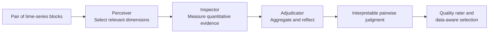

# TSQAgent: Dedicated Agentic Reasoning for Time-Series Data Quality

<p align="center">
  
</p>

<p align="center">
  <a href="#quick-start">Quick Start</a> |
  <a href="REPRODUCE.md">Reproduction</a> |
  <a href="#citation">Citation</a>
</p>

> **TL;DR.** TSQAgent identifies the quality dimensions that matter, grounds pairwise time-series judgments in quantitative evidence, and converts those judgments into interpretable, quality-aware data selection.

## Why TSQAgent?

Time-series quality is multi-dimensional: missing values, noise, rare patterns, and structural changes can matter differently for every pair and downstream task. TSQAgent addresses this with three specialized agents and a dedicated benchmark, **TSQBench**, for measuring both relevant-dimension identification and evidence-grounded quality comparison.



## Highlights

- **🧠 Reasoning-driven planning.** A GRPO-trained Perceiver focuses the analysis on the quality dimensions that are actually relevant to each pair.
- **📊 Tool-grounded inspection.** The Inspector combines LLM reasoning with statistical tools for missingness, noise, outliers, trends, frequency, amplitude, and pattern consistency.
- **⚖️ Interpretable decisions.** The Adjudicator returns a winner, confidence, and dimension-level evidence, with re-checking and re-planning when needed.
- **🎯 From judgments to better data.** Pairwise preferences train a lightweight rater for ranking samples and selecting higher-quality data for downstream tasks.

## Results at a Glance

| Capability on TSQBench | Without the proposed component | With TSQAgent component |
| --- | ---: | ---: |
| Relevant-dimension identification precision | 33-38% | 59-61% with GRPO planning |
| Dimension-wise quality comparison accuracy | 55-61% | 78-84% with analytical tools |
| Real-world evaluation | - | Quality-aware selection across 11 datasets |

The paper further shows that quality-aware selection transfers these stronger judgments into improved downstream forecasting and classification under a fixed data budget.

## Quick Start

```bash
conda create -n tsquality python=3.11 -y
conda activate tsquality
pip install -r requirements.txt

export OPENAI_API_KEY="<your_api_key>"
python main.py --model gpt-4o-mini --case noise
```

The command runs a built-in pairwise quality comparison and writes an HTML report with the reasoning trace. To use a local OpenAI-compatible server, train the Perceiver, annotate datasets, train a rater, or reproduce the paper's evaluations, follow the [reproduction guide](REPRODUCE.md).

## Using TSQAgent

```python
from config import Config, build_llm
from workflow import run_pipeline

cfg = Config(
    model="gpt-4o-mini",
    base_url="https://api.openai.com/v1",
    api_key="",  # Read OPENAI_API_KEY from the environment.
    enable_thinking=False,
    max_steps_per_dimension=6,
    max_recheck=2,
    max_replan=1,
)

result = run_pipeline(
    input_data={
        "dataset_description": "Industrial temperature sensor, 1-min sampling",
        "series_A": [...],
        "series_B": [...],
        "timestamps": [...],
    },
    llm=build_llm(cfg),
    config=cfg,
)

print(result["winner"])       # "A" | "B" | "tie"
print(result["confidence"])   # 0.0 - 1.0
print(result["explanation"])  # dimension-level evidence
```

## Reproducibility

The full research pipeline is documented in [REPRODUCE.md](REPRODUCE.md):

1. Generate synthetic TSQBench-style training pairs.
2. Fine-tune the Perceiver with quality-tailored GRPO.
3. Collect pairwise judgments over real-world datasets.
4. Train a dataset-specific or meta-learning quality rater.
5. Run data-selection experiments for forecasting and classification.

## Repository Map

| Directory | Purpose |
| --- | --- |
| `agents/` | Perceiver, Inspector, and Adjudicator workflow |
| `tools/` | Statistical tools used for evidence collection |
| `training/` | Synthetic data construction and Perceiver GRPO training |
| `annotation/` | Pairwise quality annotation workflows |
| `meta_learning_rater/` | Dataset-specific and cross-dataset quality raters |
| `evaluation/` | Downstream forecasting and classification experiments |

## Citation

If TSQAgent or TSQBench is useful for your research, please cite:

```bibtex
@inproceedings{wu2026tsqagent,
  title={TSQAgent: Rating Time Series Data Quality via Dedicated Agentic Reasoning},
  author={Wu, Shunyu and Li, Dan and Ye, Haozheng and Feng, Weibin and Lou, Jian and Zhang, Bo and Feng, Wenjie and Guo, Chenjuan and Ng, See-Kiong},
  booktitle={Advances in Neural Information Processing Systems},
  year={2026}
}
```
